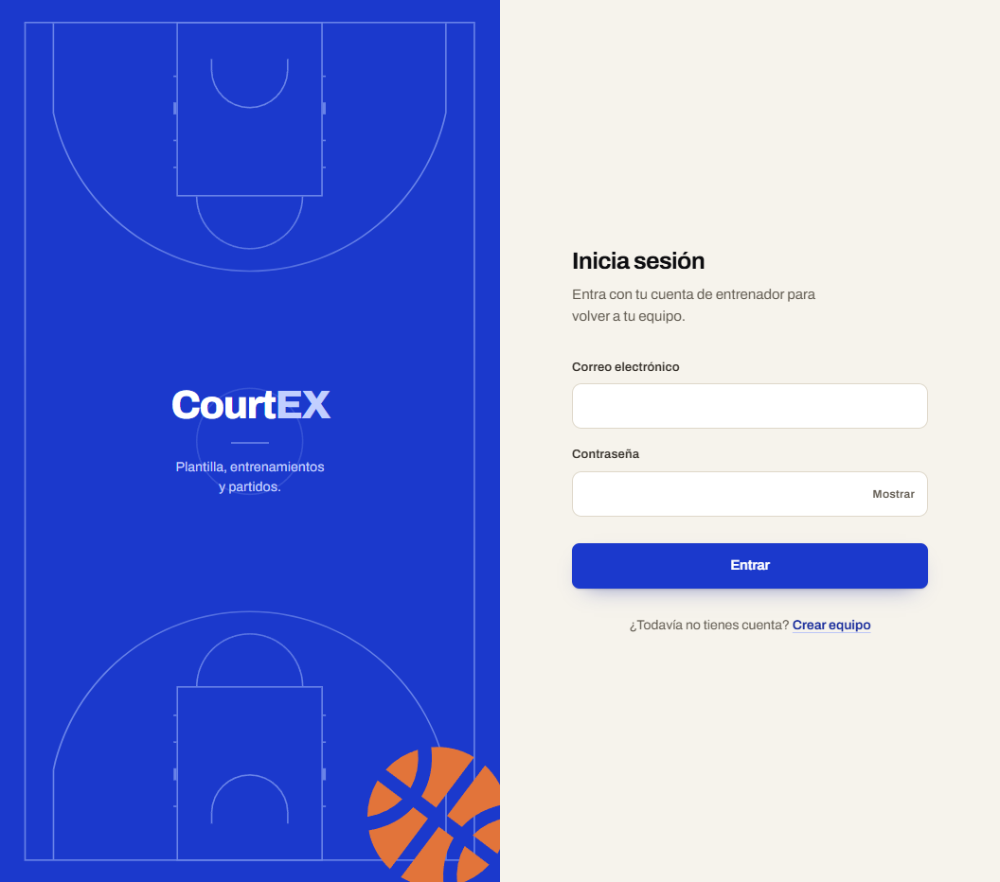

# CourtEX

**La planilla del entrenador de baloncesto, sin papel.**

Aplicación web para dirigir un equipo desde una tablet o un teléfono: plantilla, rutinas,
calendario, asistencia y evaluación. Pensada para usarse en la cancha, donde la señal no siempre
acompaña.

## Qué hace

### Equipos y personas

- Un entrenador puede llevar **varios equipos**, y cada uno está completamente separado del resto.
- **Tres roles**: entrenador, subentrenador y jugador.
  - El entrenador tiene el control total del equipo y es el único que da de alta a los demás.
  - El subentrenador hace casi lo mismo, salvo las acciones que el entrenador debe aprobar.
  - El jugador ve su información y la de su equipo, sin poder modificarla.
- Invitaciones por correo para asistentes y jugadores.

### Plantilla

- Ficha por jugador: dorsal, posición, mano y ojo dominante, altura, peso, fecha de nacimiento y
  datos de contacto.
- Representante legal para los jugadores menores de edad.
- Búsqueda por nombre o dorsal, orden por apellido o dorsal, y archivo sin perder el historial.
- El dorsal no se repite entre los jugadores activos del mismo equipo.

### Rutinas

- Rutinas de entrenamiento con sus ejercicios: categoría, duración, series y repeticiones.
- Reordenar, editar y eliminar ejercicios.
- Una rutina se puede asignar a un entrenamiento del calendario.

### Calendario

- Entrenamientos y partidos en una vista mensual.
- Cada evento con fecha, hora, sede y —si es partido— rival.
- Cancelar y reactivar un evento sin borrarlo.

### Privacidad

- Cada equipo ve únicamente su propia información.
- Ninguna pantalla es pública ni compartible por enlace.
- La imagen de un jugador menor de edad requiere autorización registrada de su representante.
- Los datos personales se reducen a lo necesario para gestionar el equipo: no se piden documentos
  ni información de salud.

## Estado

| Módulo | Estado |
|---|---|
| Acceso y registro de entrenadores | Hecho |
| Equipos, roles e invitaciones | Hecho |
| Plantilla de jugadores | Hecho |
| Rutinas de entrenamiento | Hecho |
| Calendario de entrenamientos y partidos | Hecho |
| Asistencia y evaluación por sesión | En desarrollo |
| Partido en vivo y estadísticas | En desarrollo |
| Dashboards de partido, jugador y equipo | En desarrollo |
| Recordatorios automáticos | Pendiente |

## Sobre este repositorio

Muestra el código de la aplicación. La configuración de los servicios, las credenciales y el
modelo de datos **no** se publican.

Los nombres, dorsales y equipos de las capturas son ficticios.

## Créditos

Cancha y balón: ver [`CREDITS.md`](CREDITS.md).

## Licencia

MIT — ver [`LICENSE`](LICENSE).
